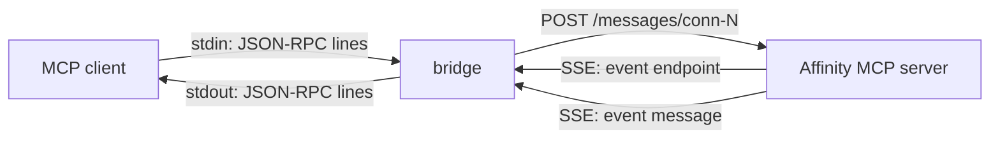

# `bin/` — the stdio↔SSE bridge

This directory holds the transport shim that lets any **stdio** MCP client talk to Affinity's
**SSE**-only MCP server. It is a proxy, not the server: all tools, resources and protocol semantics
come from Affinity (`liblibmcp.dylib`); the bridge only moves JSON-RPC between two transports and
patches the handshake.

| File | Role |
| --- | --- |
| `run` | Bash wrapper. Resolves `affinity-bridge.mjs` relative to its own location, so it works from any CWD, then runs `node` on it. |
| `affinity-bridge.mjs` | The bridge itself. Directly executable (`#!/usr/bin/env node`). |

Analysis of the server behind the bridge — protocol, tool gaps, measurements — is in
[`../mcp-server-report.md`](../mcp-server-report.md).

## Message flow



1. The bridge opens `GET /sse` and waits for the server's `event: endpoint`, which names the URL to
   POST requests to. That URL is connection-scoped (`/messages/conn-N`) and changes on reconnect.
2. Each client line on stdin is POSTed to that endpoint.
3. Responses arrive as `event: message` on the SSE stream and are written to stdout.
4. `event: heartbeat` and any other event type are ignored.

**stdout carries JSON-RPC and nothing else.** Every diagnostic goes to stderr, prefixed
`[affinity-bridge]`. A stray `console.log` in this file would corrupt the client's stream.

## Source layout

`affinity-bridge.mjs` is a single file, split by `// ---- … ----` markers:

| Section | Contents |
| --- | --- |
| *(top)* | Config constants, the `RETRYABLE_TOOLS` set, module state |
| helpers | `log`, `debug`, `messageOf`, `sleep`, `parseJson` |
| stdout | `writeJsonRpc`, `writeLine`, `writeErrorResponse` |
| lifecycle | `resetEndpoint`, `clearPending`, `shutdown`, `fail` |
| protocol version translation | `toAffinityProtocolVersion`, `toClientProtocolVersion` |
| request tracking | `registerPending`, `expirePending`, `requestLabel`, `isRetryableFailure`, `retryRequest` |
| SSE | `createSseParser`, `handleSseEvent`, `handleRemoteMessage`, `consumeSse`, `dropConnection`, `connectToAffinity` |
| POST | `postToAffinity` |
| reconnect loop | `run` |
| stdio | `handleClientLine`, `start` |

## State

| Variable | Purpose |
| --- | --- |
| `pendingClientProtocolVersions` | `initialize` request id → the client's protocol version, so the response can be restored |
| `pendingRequests` | id → `{ message, attempts, timer }` for requests awaiting a response |
| `expiredIds` | Ids that already timed out; a late response for one is dropped |
| `messageEndpoint` | Discovered POST URL for the current connection |
| `endpointDeferred` | Promise for that URL; recreated on every connection attempt |
| `discoveryTimer` | Fires if no `endpoint` event arrives in time |
| `sseController` | `AbortController` for the live SSE request |
| `writeChain` | Serialises stdout writes (order + backpressure) |
| `shuttingDown` | Set once; makes every loop and handler bail out |

## Behaviour

### Protocol version translation

The server accepts exactly one version (`2025-11-25` in Affinity 3.3.1). On `initialize` the bridge
rewrites `params.protocolVersion` to `AFFINITY_MCP_PROTOCOL_VERSION` and remembers what the client
sent, keyed by request id. When that response comes back it restores the client's value in
`result.protocolVersion`, so the client sees the version it asked for. Both directions copy the
message rather than mutating it.

### Request tracking and timeouts

`registerPending` records any message that has both an `id` and a `method`, and arms a timer
(`AFFINITY_BRIDGE_TIMEOUT_MS`, default 300 s). If nothing arrives, `expirePending` emits a
`-32001` error for that id and adds it to `expiredIds`, so a late response is discarded instead of
being delivered twice. Notifications (no id) are never tracked.

### Retry policy — read-only tools only

When a response carries an error matching `authorization channel closed` (a transient render
failure), the bridge re-sends the request **once**, but only if the tool is in `RETRYABLE_TOOLS`
(`render_*`, doc/hint/library reads). The tool name comes from `params.name` via `requestLabel`,
not from the JSON-RPC `method` — every tool call shares `method: "tools/call"`.

**`execute_script` and other mutating tools are never re-sent.** A duplicated script would repeat its
side effects. Do not add mutating tools to that set.

The transient error is suppressed: the client only sees the retry's response, or the error if the
retry also fails.

### Endpoint rotation (404/410)

A rotated endpoint answers 404/410. `postToAffinity` then calls `dropConnection`, which resets the
endpoint and aborts the stream; the reconnect loop discovers a fresh endpoint, and the same request
is retried once. A second failure is reported to the client.

`resetEndpoint` deliberately does **not** reject the previous promise — a POST already holding the old
endpoint keeps a valid (if stale) URL instead of being torn down mid-flight.

### Reconnect loop

`run()` is an infinite loop: connect, and when the stream ends, log, reset the endpoint, sleep, and
retry. Backoff starts at 250 ms, doubles to a 5 s cap, and resets to 250 ms whenever the previous
connection had actually discovered an endpoint. It returns only on shutdown.

### Endpoint discovery timeout

`connectToAffinity` arms `discoveryTimer` before the fetch. If no `endpoint` event arrives within
`AFFINITY_BRIDGE_ENDPOINT_TIMEOUT_MS` (default 10 s), it aborts the request so the loop retries rather
than blocking every client request forever.

Streams are terminated with `sseController.abort()`, **not** `reader.cancel()` — the latter leaves a
pending `read()` unresolved and the loop never advances.

### POST bodies

If Affinity answers a POST with `application/json`, the body is parsed and its JSON-RPC messages are
forwarded like SSE messages. Otherwise the body is drained (cancelled) to free the socket, because
responses normally arrive over SSE.

### Shutdown

`shutdown` is idempotent. It clears every pending timer, rejects the endpoint promise (releasing
anything awaiting it), aborts the SSE request, closes readline, sets `process.exitCode`, and force-exits
after a 1.5 s unref'd grace period. Queued stdout writes drain in that window, so a final JSON-RPC
message is not truncated. Triggers: stdin close, `SIGINT`, `SIGTERM`, `EPIPE` on stdout (clean exit),
and fatal errors (exit 1).

## Configuration

| Variable | Default | Purpose |
| --- | --- | --- |
| `AFFINITY_MCP_SSE_URL` | `http://[::1]:6767/sse` | Affinity's SSE endpoint |
| `AFFINITY_MCP_PROTOCOL_VERSION` | `2025-11-25` | Version sent to Affinity |
| `AFFINITY_BRIDGE_TIMEOUT_MS` | `300000` | Per-request timeout |
| `AFFINITY_BRIDGE_ENDPOINT_TIMEOUT_MS` | `10000` | Endpoint-discovery timeout |
| `AFFINITY_BRIDGE_DEBUG` | unset | `1` logs every forwarded method/id and response |

## Reading the logs

All on stderr. Useful when diagnosing a client that "hangs":

| Message | Meaning |
| --- | --- |
| `Translating initialize protocol X -> Y` | Handshake rewritten |
| `Affinity SSE connected; message endpoint discovered` | Transport is up; requests can flow |
| `No endpoint event after N ms; dropping connection` | Server accepted the stream but never named an endpoint |
| `Dropping SSE connection: …` | Endpoint rotated (404/410) |
| `SSE connection lost: …` / `Reconnecting in N ms` | Stream closed or unreachable; backoff running |
| `Retrying <tool> (id N), attempt 1` | Transient read-only failure re-sent |
| `Request <id> (<tool>) timed out after N ms` | No response; client received `-32001` |
| `Request failed: …` | POST failed; client received `-32001` |
| `Fatal error: …` / `Shutting down (exit N)` | Process ending |

## Rules for maintainers

1. **Never write to stdout** except through `writeJsonRpc`.
2. **Never add a mutating tool to `RETRYABLE_TOOLS`.**
3. **Resolve the tool name** with `requestLabel`, not `request.method`.
4. **Abort the stream** with the `AbortController`; `reader.cancel()` does not wake the read loop.
5. **Keep `resetEndpoint` non-rejecting** — it must not break in-flight POSTs.
6. **Preserve ordering**: writes go through `writeChain`; stdin lines are handled through a promise
   queue in `start`.
7. **Clear timers** you create (all are `unref()`'d so they cannot keep the process alive).

Two bugs found by the test suite are worth remembering, because both looked correct: retry keyed on
`method` instead of `params.name` (dead code), and discovery timeout using `reader.cancel()` (silent
no-op). Both are covered by `tests/` — see below.

## Tests

Integration tests spawn this file as a real subprocess against a fake SSE server:

```bash
node --test tests/*.test.mjs
```

14 cases cover the handshake, forwarding, heartbeat handling, reconnect, endpoint rotation, request
timeout, transient-error retry (and that mutating tools are *not* retried), POST-body responses,
concurrency, large payloads, endpoint-discovery timeout, clean exit and non-fatal POST failures. See
[`../tests/README.md`](../tests/README.md) for the matrix and how to add a case.

For a live-server check, use [`SMOKE_TESTS.md`](SMOKE_TESTS.md).
